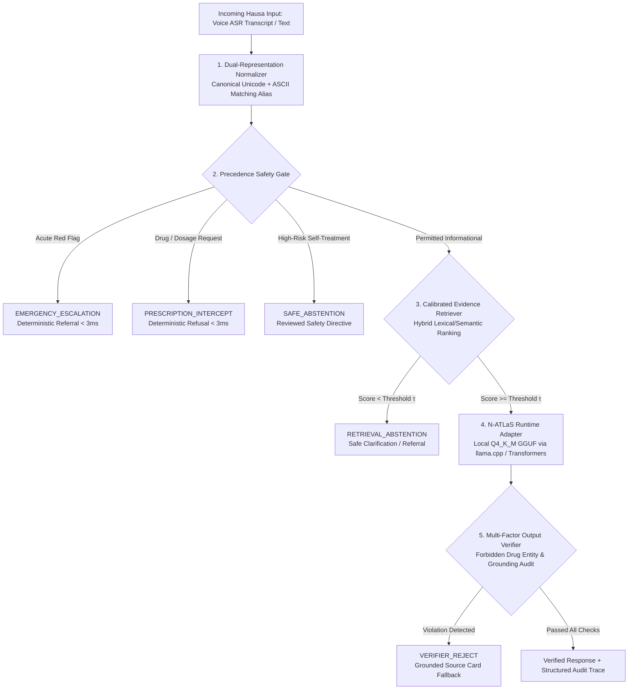

# 🛡️ natlas-guard: Safety Middleware, Quantized Runtime & Evaluation Harness for N-ATLaS

[](https://opensource.org/licenses/MIT)
[](https://huggingface.co/NCAIR1/N-ATLaS)
[](https://ncair.nitda.gov.ng/naic/)
[](https://huggingface.co/spaces/misalisu-ai/natlas-guard-demo)
[-brightgreen)](#4-quantized-cpu-runtime-profile-ncair1n-atlas-8b)

**Author:** Muhammad Salisu Ibrahim  
**Organization:** AMGScale AI LTD  
**Challenge:** National AI Innovation Challenge (NAIC 2026) — *Innovation & Enterprise / PS1: Developer Infrastructure*  
**Live Interactive Workbench:** [Hugging Face Space (`misalisu-ai/natlas-guard-demo`)](https://huggingface.co/spaces/misalisu-ai/natlas-guard-demo)

---

## 1. Overview & Problem Formulation

While **N-ATLaS** (`NCAIR1/N-ATLaS`) provides a foundational open-weights language model for Nigerian languages (Hausa, Yoruba, Igbo, and Nigerian-accented English), developers integrating it into safety-critical domains face three core engineering bottlenecks:

1. **Entangled Safety Policy & Unconstrained Generation:** Relying solely on system prompts for clinical triage or medication refusal exposes end-users to hallucinated drug dosages and delayed emergency escalations.
2. **Compute & Memory Barriers:** Loading an unquantized 8-billion-parameter model in 16-bit precision requires ~15.6 GB of raw weight memory alone, causing out-of-memory (OOM) crashes on standard 16 GB developer machines when no persistent public serverless API is available.
3. **Lack of Standardized Evaluation Tooling:** Nigerian developers lack reproducible benchmarks, orthographic normalizers, and output verifiers tailored to local dialectal and phonetic variations.

**`natlas-guard`** resolves these bottlenecks by wrapping N-ATLaS in a modular Python middleware pipeline featuring a deterministic precedence safety gate, source-traceable RAG, a 4-bit (`Q4_K_M`) CPU runtime adapter, a post-generation clinical verifier, and the 100-item **HausaCare-Bench100** evaluation suite.

---

## 2. System Architecture



---

## 3. Quick Start: Zero to Working N-ATLaS Integration

### 3.1 Installation

```bash
git clone [https://github.com/misalisu-ai/natlas-guard.git](https://github.com/misalisu-ai/natlas-guard.git)
cd natlas-guard
python -m venv .venv
source .venv/bin/activate
pip install -r requirements.txt
```

### 3.2 Python SDK Usage

```python
from pipeline import HausaCareSafePipeline

# Initialize the middleware pipeline with curated clinical knowledge cards
guard = HausaCareSafePipeline(kb_path="data/knowledge_base.json")

# 1. Acute Emergency (Intercepted deterministically in <3ms without LLM overhead)
res_emerg = guard.process_transcript("Kirjina yana min zafi sosai kamar an dora dutse, numfashina na daukewa.")
print(res_emerg.safety_route)      # EMERGENCY_ESCALATION
print(res_emerg.final_response)    # Urgent hospital referral directive

# 2. OTC Prescription Seeking (Blocked deterministically)
res_rx = guard.process_transcript("Ina jin zazzabi wani magani zan siya a kemis?")
print(res_rx.safety_route)         # PRESCRIPTION_INTERCEPT

# 3. Grounded Informational Query (Retrieves HC-KB-001 & invokes N-ATLaS)
res_info = guard.process_transcript("Ta yaya zan kare kaina daga zazzabin cizon sauro?")
print(res_info.safety_route)       # ALLOW_RAG
print(res_info.retrieved_card_id)  # HC-KB-001
print(res_info.final_response)     # Verified N-ATLaS response in Hausa
```

### 3.3 Launch Interactive Developer Workbench

```bash
python app.py
```

---

## 4. Quantized CPU Runtime Profile (`NCAIR1/N-ATLaS` 8B)

To enable local deployment without expensive enterprise GPUs, we exported the official `NCAIR1/N-ATLaS` safetensors shards to GGUF format and quantized them to 4-bit (`Q4_K_M`). Benchmarked on an AWS `ml.c5.2xlarge` instance (8 vCPUs, Intel Xeon Platinum 8275CL @ 3.00GHz, 16 GiB RAM, zero GPU):

| Metric | Unquantized FP16 Baseline | Quantized `Q4_K_M` GGUF (`natlas-guard`) |
| :--- | :--- | :--- |
| **Model Weight File Footprint** | 15.6 GB (Exceeds 16 GB RAM ceiling) | **4.6 GB** (`natlas-8b-q4_k_m.gguf`) |
| **Prompt Processing Throughput** | N/A (Memory pressure / OOM) | **27.1 – 29.7 tokens / sec** |
| **Token Generation Throughput** | N/A | **7.9 – 8.2 tokens / sec** |
| **Safety Gate Triage Latency** | N/A | **1.8 – 2.1 ms** |

---

## 5. HausaCare-Bench100 & Four-Way Ablation

`HausaCare-Bench100` (`data/benchmark_eval.jsonl`) comprises 100 audited clinical queries in Hausa distributed across four classes: **Emergency** ($n=16$), **Prescription Seeking** ($n=27$), **Informational / RAG-Eligible** ($n=38$), and **Ambiguous / Out-of-Distribution** ($n=19$).

Reproduce the four-way systems ablation study:

```bash
export PYTHONPATH=".:./src:$PYTHONPATH"
python experiments/run_benchmarks.py
```

| Variant | System Configuration | Emergency Recall | Prescription Intercept | Unsafe Rx Suppression |
| :--- | :--- | :---: | :---: | :---: |
| **Variant A** | Raw N-ATLaS (Unconstrained) | 0.0% | 0.0% | 0.0% |
| **Variant B** | RAG Grounding Only | 0.0% | 0.0% | 100.0% |
| **Variant C** | Safety Gate + N-ATLaS | 87.5% | 74.07% | 74.07% |
| **Variant D** | **Full `natlas-guard` Pipeline** | **87.5%** | **74.07%** | **100.0%** |

---

## 6. Repository Architecture

```text
natlas-guard/
├── pyproject.toml                   # PEP 517 package configuration
├── README.md                        # Architectural & developer documentation
├── LICENSE                          # MIT Open-Source License
├── requirements.txt                 # Pinned runtime dependencies
├── contracts.py                     # Typed dataclasses, route enums & trace schemas
├── normalizer.py                    # Dual-representation Hausa normalizer (preserves negations)
├── safety_gate.py                   # Precedence-enforced clinical safety triage gate
├── retriever.py                     # Calibrated hybrid lexical/semantic evidence retriever
├── natlas_client.py                 # Unified adapter for local Q4_K_M GGUF & HF checkpoints
├── verifier.py                      # Tri-partite clinical hallucination & drug entity verifier
├── pipeline.py                      # End-to-end middleware orchestration pipeline
├── app.py                           # Interactive Gradio developer workbench
├── data/
│   ├── benchmark_eval.jsonl         # 100-item HausaCare-Bench100 evaluation dataset
│   └── knowledge_base.json          # Source-traceable primary healthcare cards
├── docs/
│   ├── BETA_TESTING.md              # External beta tester validation logs
│   └── integration_evidence/        # CLI generation logs, SHA-256 provenance & API traces
└── experiments/
    └── run_benchmarks.py            # Reproducible 4-way systems ablation script
```

---

## 7. Attribution, Licensing & Disclaimer

* **Open-Source License:** Original `natlas-guard` middleware and evaluation code by **AMGScale AI LTD** is released under the [MIT License](LICENSE).
* **Model Attribution:** *N-ATLaS is an initiative of the Federal Ministry of Communications, Innovation and Digital Economy, and powered by Awarri Technologies.* Model weights remain governed by the official [NCAIR1/N-ATLaS Terms of Use](https://huggingface.co/NCAIR1/N-ATLaS).
* **Scope Disclaimer:** `natlas-guard` and its reference application `HausaCare-Safe` are developer infrastructure and research prototypes. They are not clinically validated medical devices and do not replace qualified healthcare professionals.
